Courtney is an incredible guitarist and a formidable stage presence. The blistering opening set by *Body Type* set our expectations for what was coming, but I did not expect Courtney's three-piece band to make the noise they made. Supported by the steady hand of [Stella Mozgawa](https://en.wikipedia.org/wiki/Stella_Mozgawa) (who is also half of [Warpaint](https://music.apple.com/gb/artist/warpaint/305664605)'s indefatigable rhythm section, with [Jenny Lee Lindberg](https://en.wikipedia.org/wiki/Jenny_Lee_Lindberg)) on drums and [Bones Sloane](https://www.instagram.com/bonessloane/) on bass, the band played loud, electrifying rock with enviable heft and power. The audience was great, too, soaking it all in, jumping headfirst into the torrent of energy that flowed from the stage.

## Setlist

1. *Stay In Your Lane*
2. *City Looks Pretty*
3. *Avant Gardener*
4. *Small Poppies*
5. *Mantis*
6. *Same*
7. *I'm Not Your Mother, I'm Not Your Bitch*
8. *History Eraser*
9. *Need a Little Time*
10. *Another Beautiful Day*
11. *Depreston*
12. *Site Unseen*
13. *Great Advice*
14. *Elevator Operator*
15. *Sugar Plum*
16. *Wonder*
17. *Before You Gotta Go*
18. *Write a List of Things to Look Forward To*
19. *One Thing at a Time*

### Encore:
20. *Mostly Patient*
21. *Canned Tomatoes (Whole)*
22. *Pedestrian at Best*
23. *Nobody Really Cares If You Don't Go to the Party* 

## Photos

### Body Type

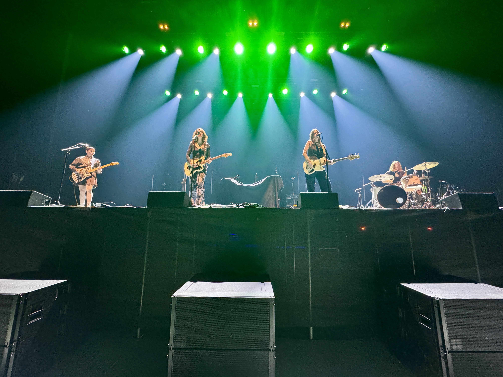

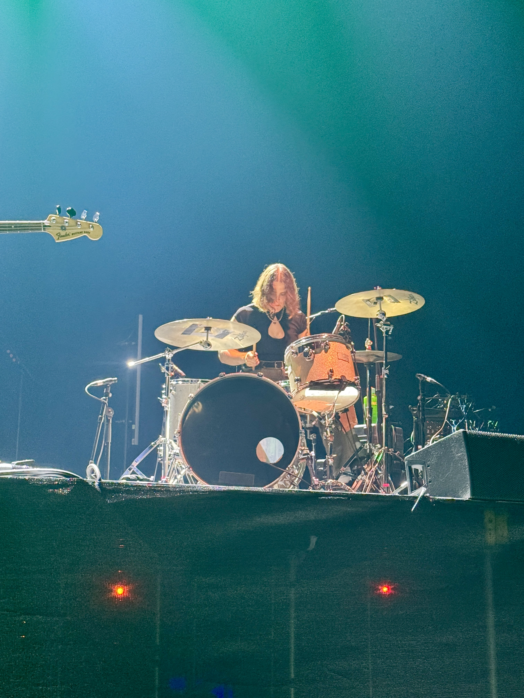

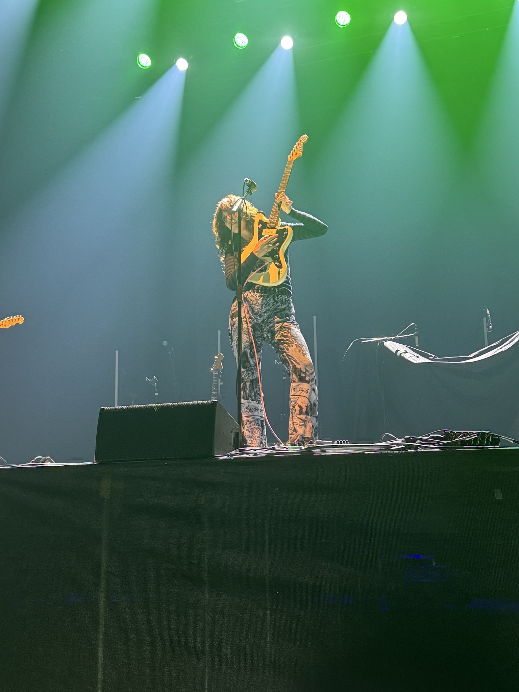

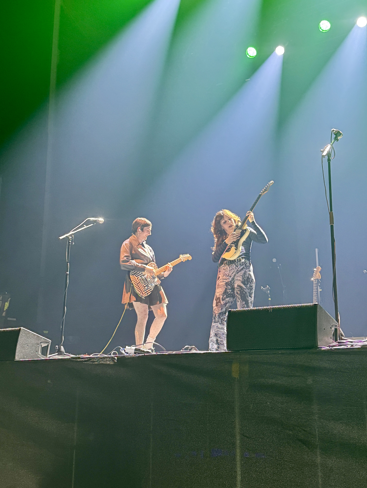

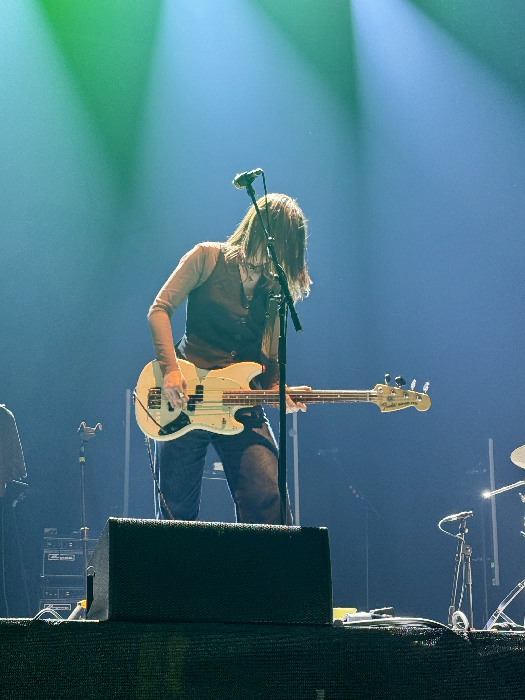

### Courtney Barnett

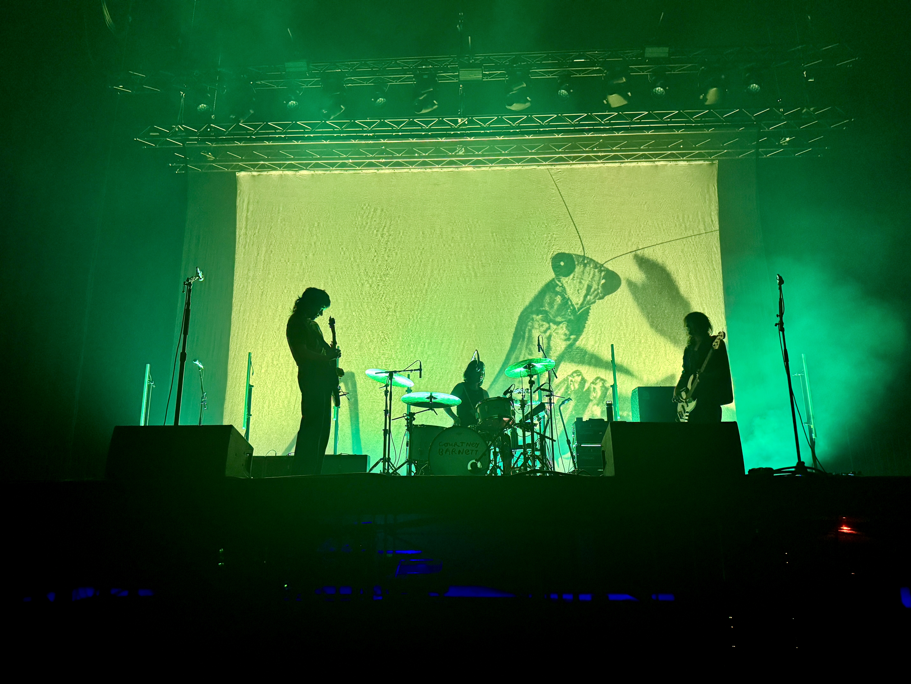

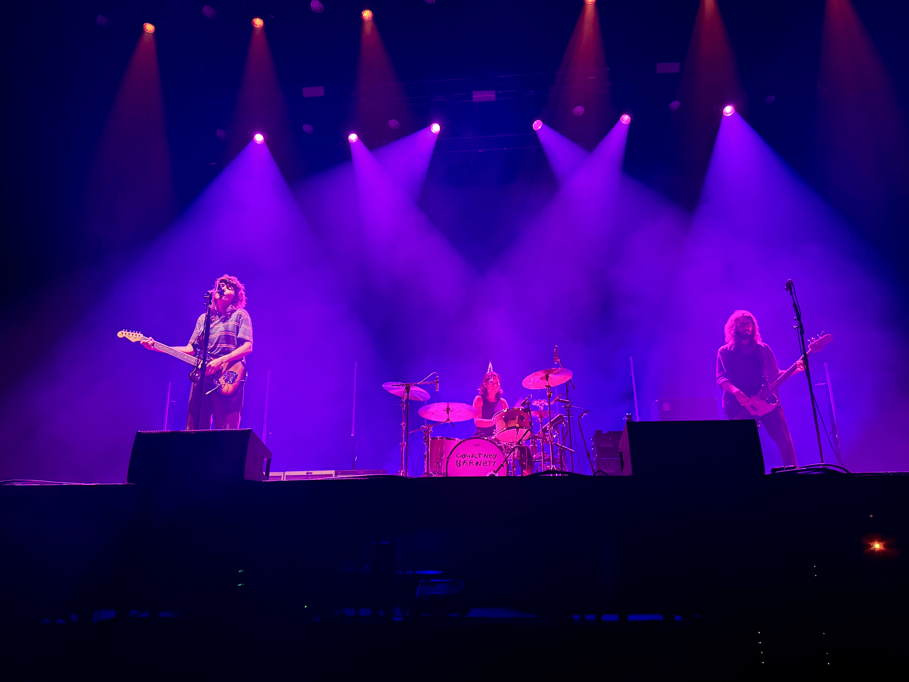

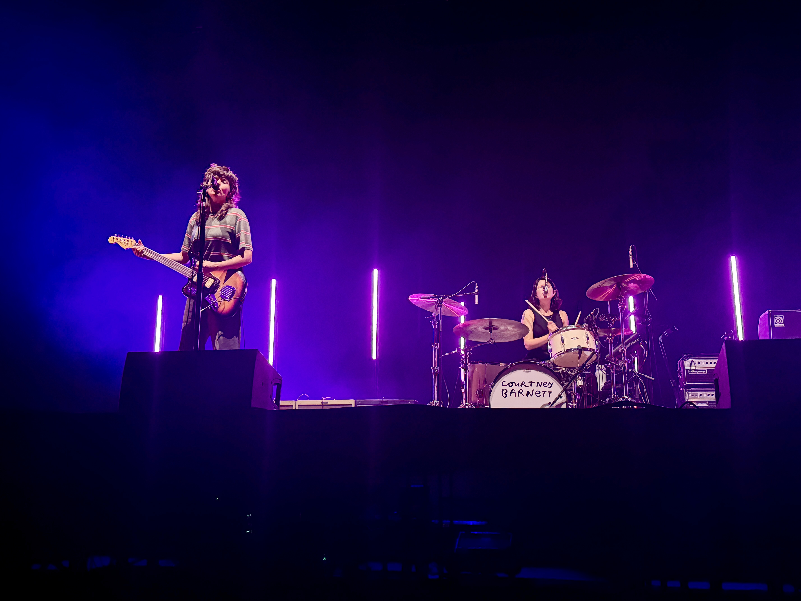

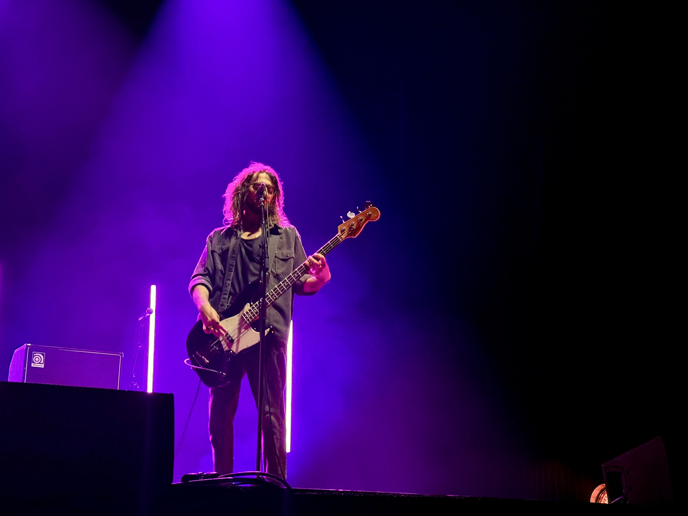

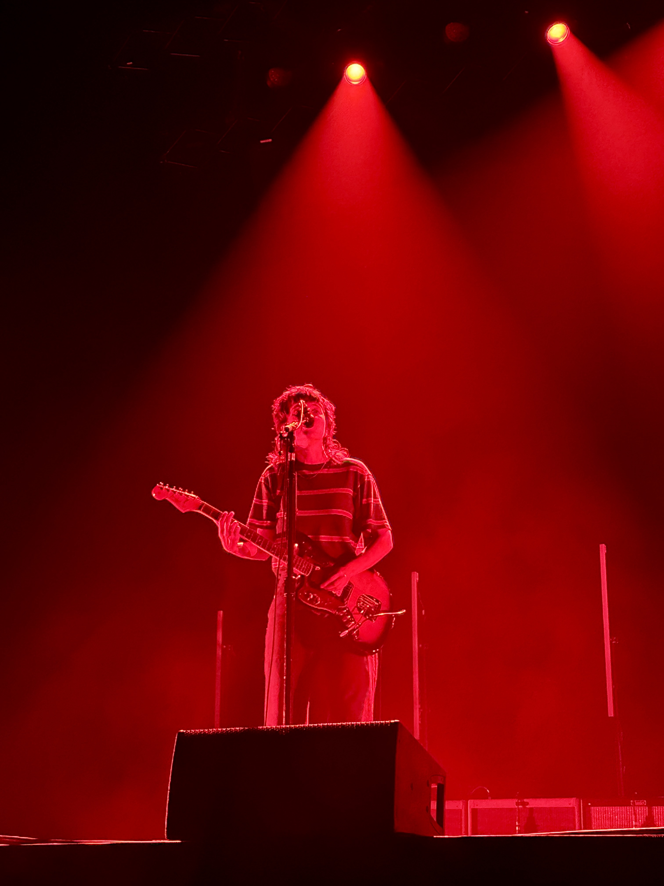

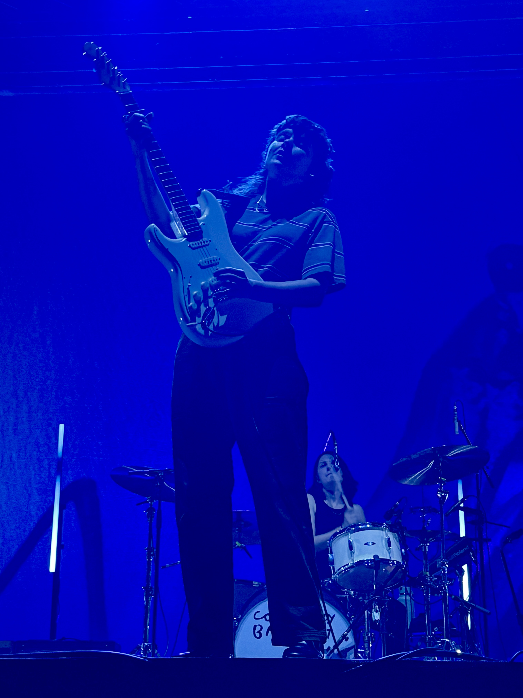

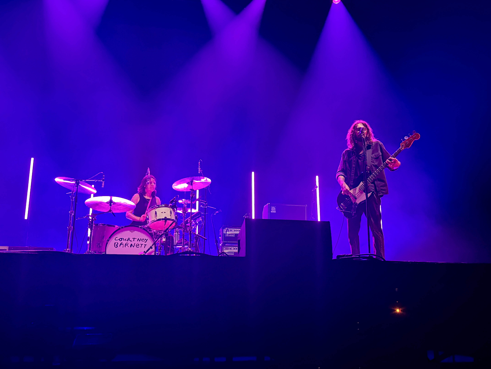

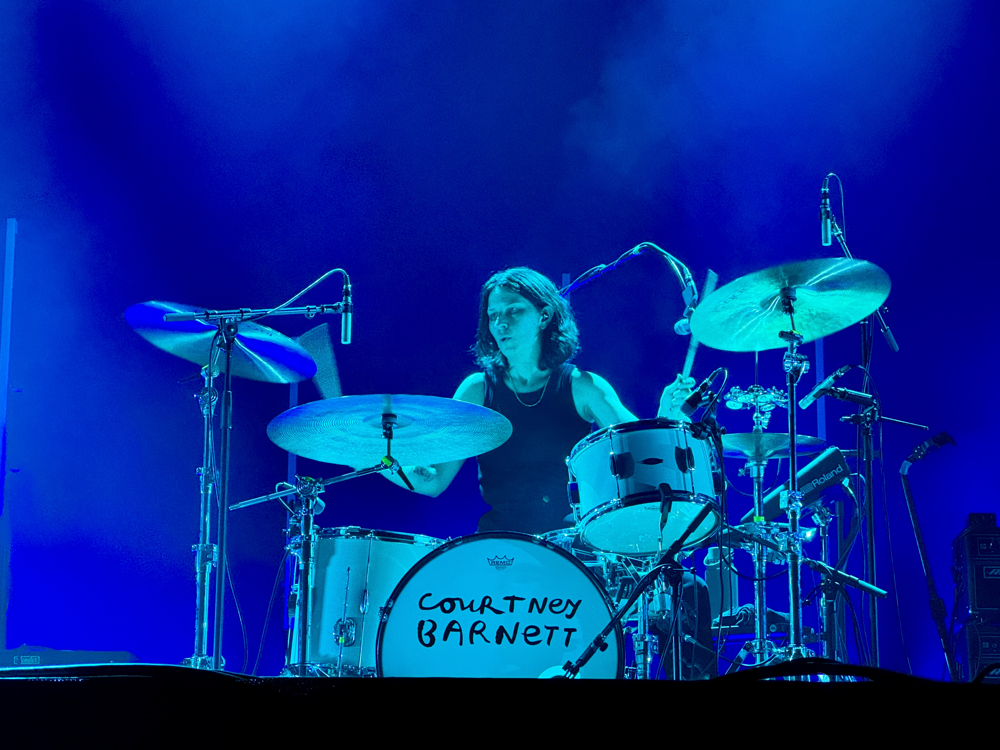