Yesterday at work, I served a customer who was looking for a draughtsman's chair (a kind of tall chair you would use at a tall counter) in a hurry. He turned out to be a crew member of the Westlife tour, and as a gesture of gratitude for looking after him, he upgraded our tickets to include the VIP experience! This entailed a tour of the stage given by the stage manager himself before the show, which included getting our photos taken on the stage, and a goodie bag! (Photos below). Thank you, Jordan!

For this tour Westlife are using a completely modular stage and lighting setup, built from the ground up at every venue by their touring crew of ~70 technicians, and a further ~80 hired locally. It takes 7 hours to put together, and around 3 hours to dismantle and pack into 17 trucks at the end of each show. They've also designed a beautiful display of drone-mounted lights, lighting up the stage and interacting with Shane, Nicky, and Kian during *You Raise Me Up*.

More than anything, I was glad to experience this with Nuwani, as Westlife's music meant a lot to us during a formative period of our lives. We danced and sang our hearts out. Music played live and loud is a joy. I keep coming back to the term *collective effervescence*. It cannot be explained, only experienced.

## Setlist

1. *World of Our Own*
2. *Uptown Girl*
3. *Bop Bop Baby*
4. *What About Now*
5. *When You're Looking Like That*
6. *What Makes a Man*
7. *I Have a Dream*
8. *I Lay My Love on You*
9. *Starlight*
10. *Queen of My Heart*
11. *Chariot*
12. *Fool Again*
13. *If I Let You Go*
14. *My Love*
15. *Unbreakable*
16. *Mandy*
17. *Flying Without Wings*
18. *Hello My Love*

### Encore:
19. *You Raise Me Up*
20. *Swear It Again*

## More photos

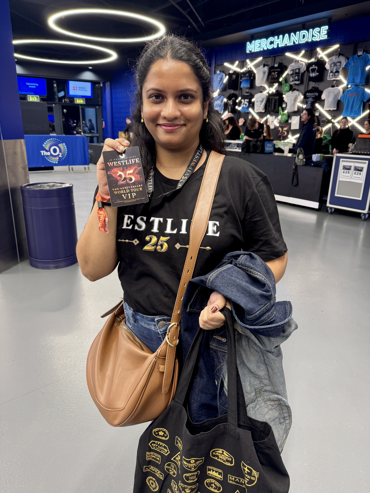

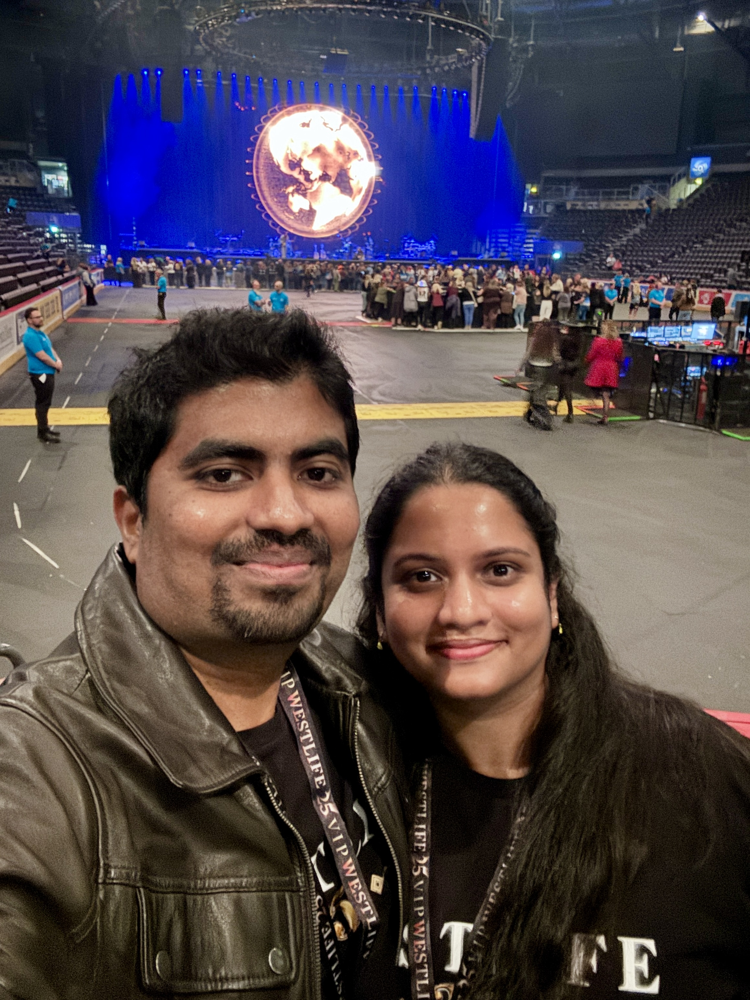

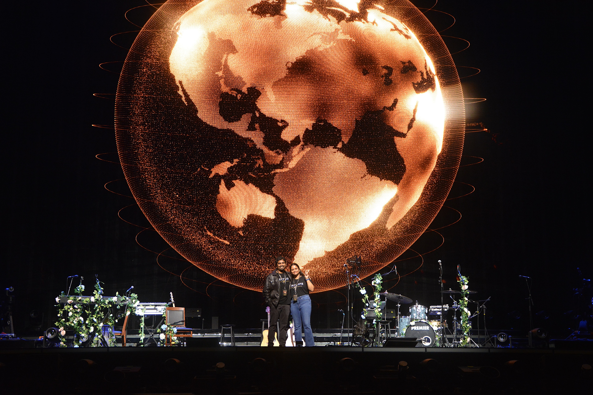

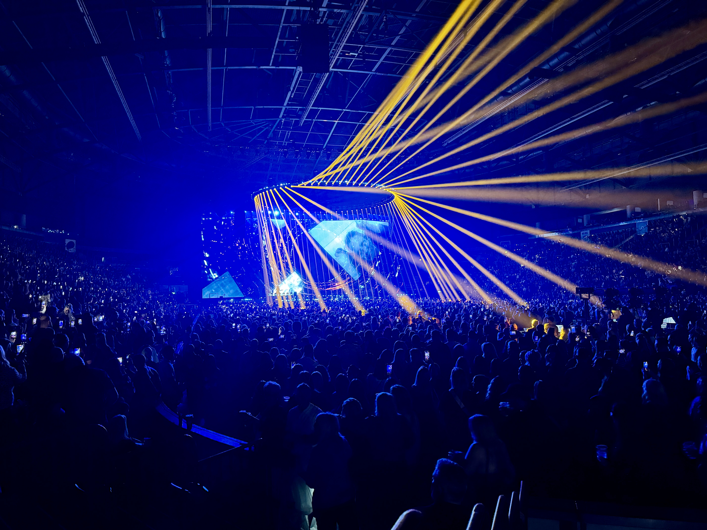

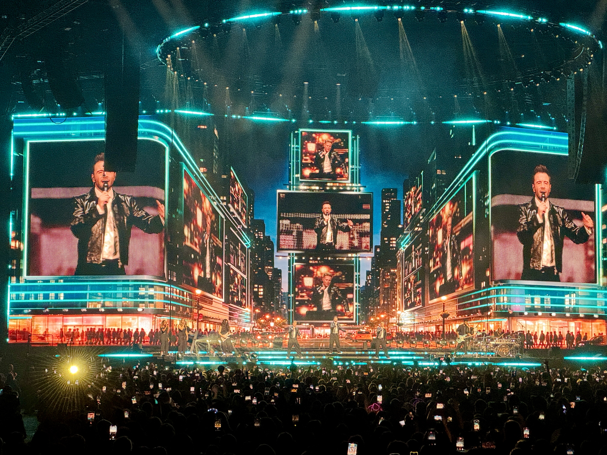

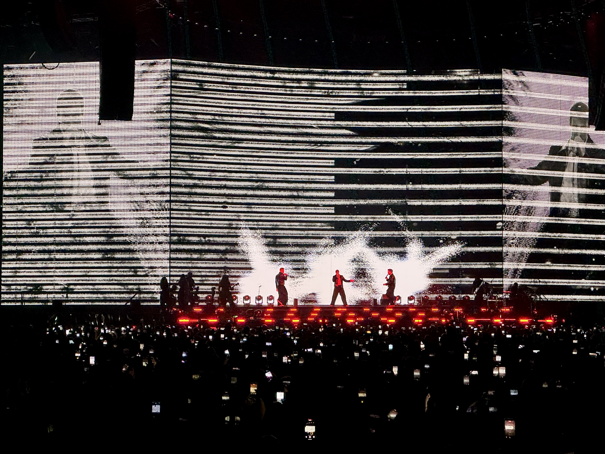

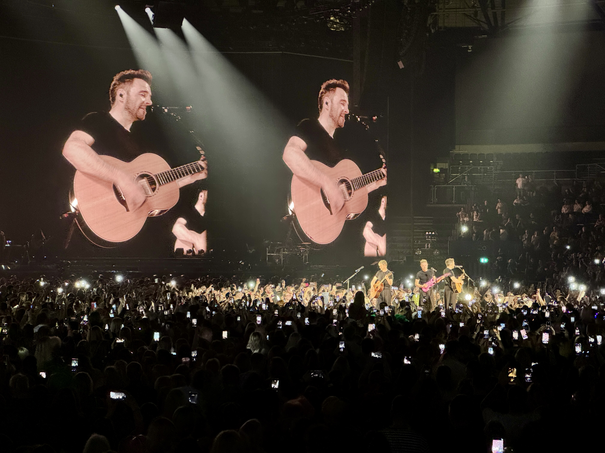

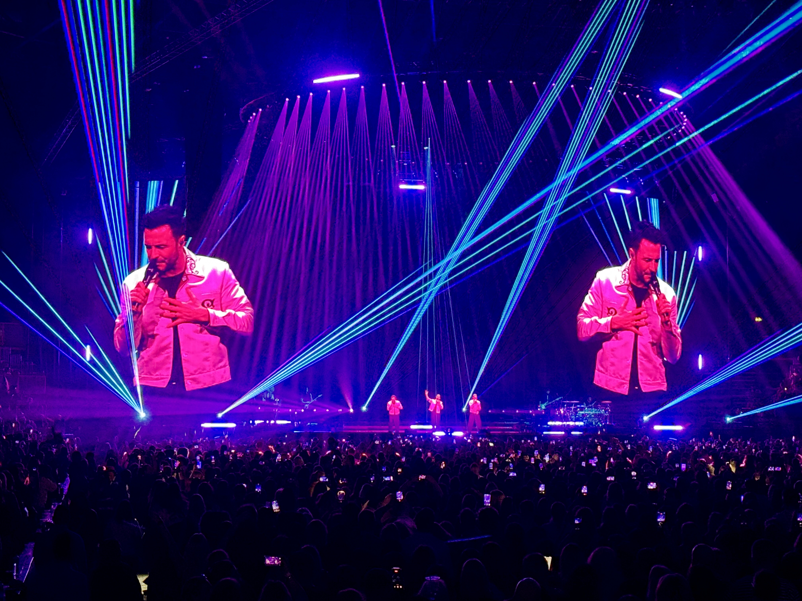

### VIP goodie bag

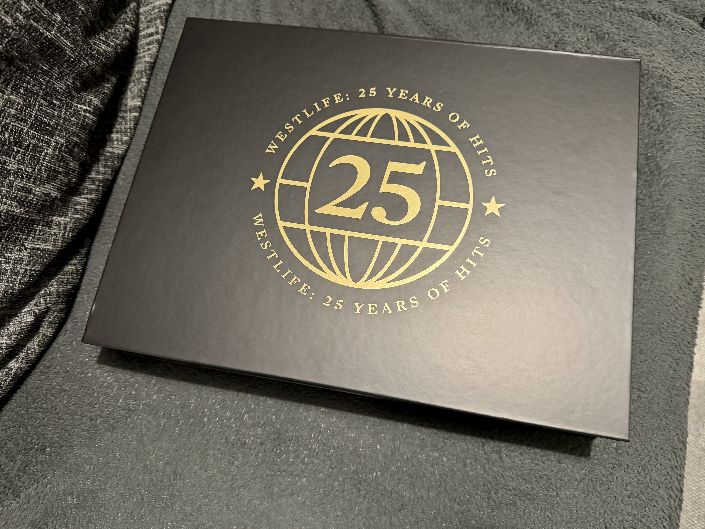

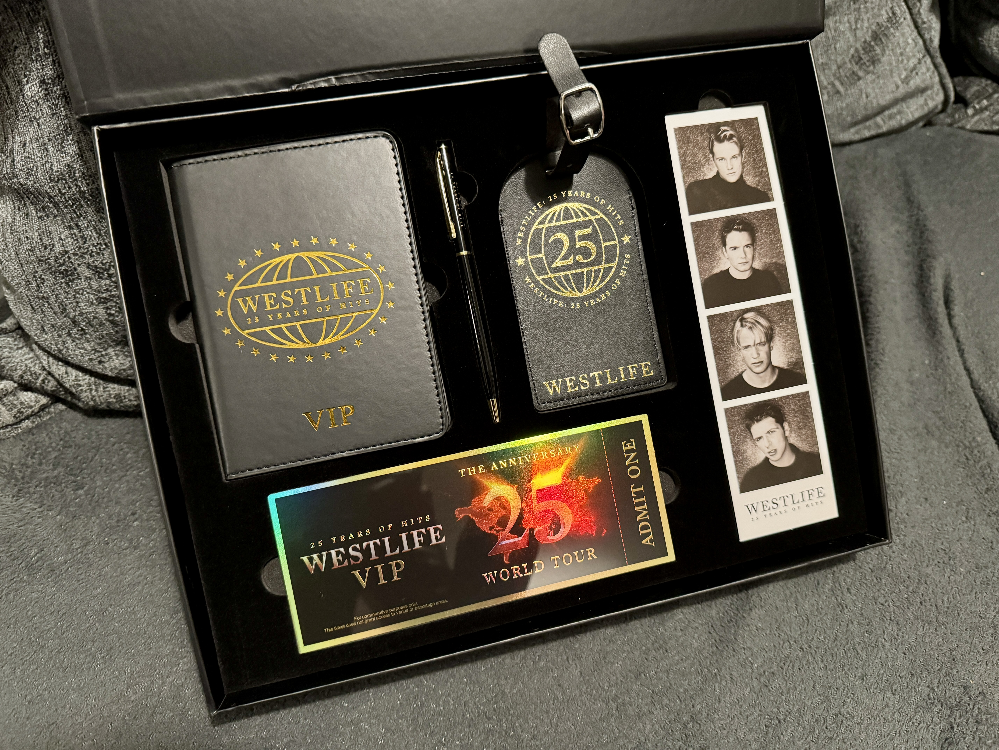

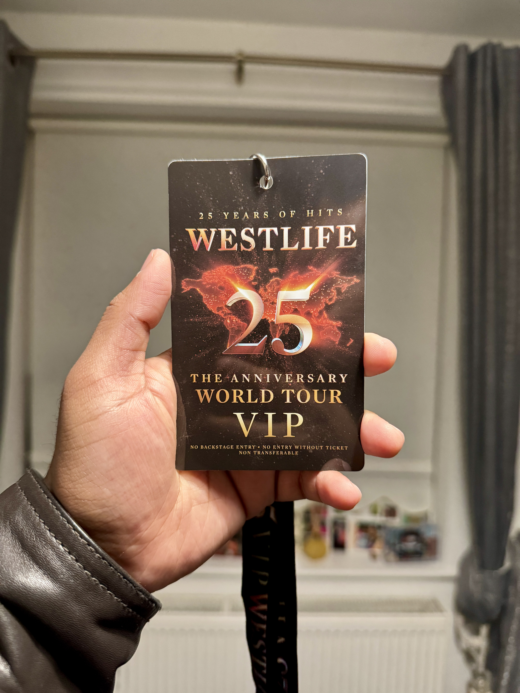

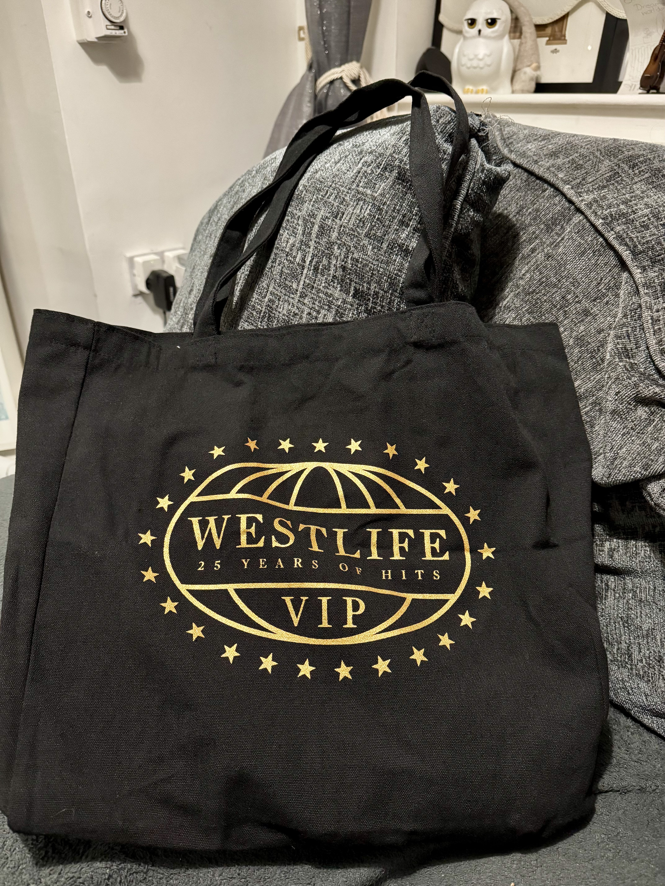

