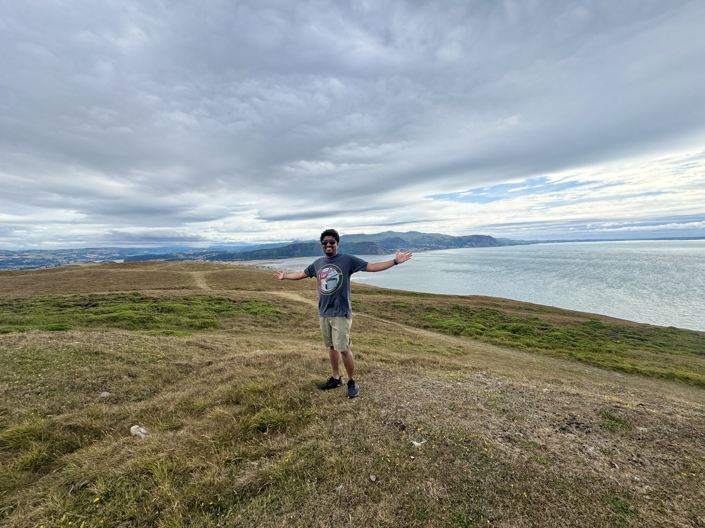

[Robert Birming](https://robertbirming.com/) has a wonderful [challenge](https://robertbirming.com/knowember/) for the month of November—a series of questions which bloggers can answer so that their readers can discover a little bit more about them.

Here are my answers.

## A photo

This is a photo my wife took on top of [*Great Orme*](https://en.wikipedia.org/wiki/Great_Orme) on our recent trip to Wales. It was a beautiful day. We walked a lot. I love walking in nature, just not in the winter.

## Name or nickname

My full legal name is Thamara Eroshana Kandabada. I don't like my second name, so I tend not to use it anywhere. But now you know.

## Where in the world I blog from

I'm originally from Sri Lanka, but I currently live in Belfast with my wife. We moved here in 2022 for her university. We love Belfast and want to settle here, but the recent [changes in visa rules](https://commonslibrary.parliament.uk/research-briefings/cbp-10267/) by the UK government may put an end to that plan. A topic for another blog post.

## What my blog is mostly about

My blog doesn't have a theme. I write about anything and everything that interests me. Recently, I've been writing about my new running habit, discovering the IndieWeb, films, and music, among other things. I try to keep a conversational tone. I take my subjects seriously, whatever they may be, but don't take myself seriously.